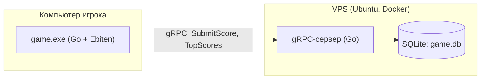

# Спасите АВ от надоедливых студентов

Игра-раннер на **Go** и **Ebiten** с общим онлайн-рейтингом. Рейтинг хранит gRPC-сервер с базой SQLite, который развёрнут на VPS в Docker.

## Скачать и играть

Версия для Windows лежит в разделе **[Releases](https://github.com/aygilyasova1-lab/runner-game/releases/latest)**: скачайте архив, распакуйте и запустите `game.exe`. Устанавливать ничего не нужно, картинки, шрифт и музыка уже внутри файла.

> Windows может показать предупреждение «Windows защитила ваш компьютер», потому что файл не подписан цифровой подписью. Нажмите «Подробнее» и «Выполнить в любом случае».

Рейтинг работает, пока доступен сервер. Если он недоступен, игра всё равно запускается, просто без таблицы лидеров.

## Управление

| Где | Клавиша | Действие |
|---|---|---|
| Меню | Ввод с клавиатуры | Имя игрока |
| Меню | ← / → | Выбор фона |
| Меню и стартовый экран | ENTER | Дальше / начать игру |
| Игра | ↑ | Прыжок |
| Игра | ↓ | Пригнуться |
| Конец игры | Пробел | Играть заново |

## Что есть в игре

- **Препятствия** разной высоты: через одни надо перепрыгнуть, под другими пригнуться. Игра постепенно ускоряется.
- **Вода и льдина.** Иногда дорогу перекрывает вода. Нужно сесть на льдину, где ждёт Леонардо Ди Каприо: игра ускоряется, преследователи отстают. Перед концом воды льдина начинает тонуть, и надо успеть спрыгнуть на землю.
- **Велосипедист.** Если добежать до него, герой забирает велосипед, на какое-то время ускоряется, а преследователи исчезают.
- **Преследователь** догоняет, если игрок зацепил препятствие.
- **Общий рейтинг.** После проигрыша результат отправляется на сервер, который хранит лучший счёт каждого игрока и показывает топ-10.
- Выбор фона, ввод имени, стартовый экран, музыка.

## Архитектура



Игра полностью работает на компьютере игрока. К серверу она обращается только в конце партии: отправляет имя и счёт и получает топ-10. Запросы идут в отдельных горутинах, поэтому игра не зависает, даже если сервер медленный или выключен.

Сервер разбит на три слоя:

1. `server` запускает программу и собирает слои вместе.
2. `service` принимает gRPC-запросы, проверяет данные и формирует ответы.
3. `storage` отвечает только за базу данных и ничего не знает про gRPC.

## Технологии

Go · Ebiten v2 · gRPC · Protocol Buffers · SQLite (`modernc.org/sqlite`, без cgo) · Docker · Docker Compose · Ubuntu VPS

## Структура проекта

```
.
├── main.go              # точка входа игры
├── game/                # игра: логика, отрисовка, клиент рейтинга
├── assets/              # картинки, шрифт, музыка (вшиваются в exe через go:embed)
├── gamepb/              # game.proto и сгенерированный gRPC-код
├── server/              # точка входа сервера рейтинга
├── service/             # gRPC-обработчики
├── storage/             # работа с базой SQLite
├── Dockerfile           # сборка образа сервера
└── docker-compose.yml   # запуск сервера, база хранится в ./data
```

## Запуск из исходников

Понадобятся Go 1.26 и Windows. Код для `gamepb` уже сгенерирован и лежит в репозитории. Если меняете `game.proto`, нужен установленный `protoc` с плагинами `protoc-gen-go` и `protoc-gen-go-grpc`:

```bash
protoc --go_out=. --go_opt=paths=source_relative \
       --go-grpc_out=. --go-grpc_opt=paths=source_relative \
       gamepb/game.proto
```

Запуск:

```bash
# 1. сервер рейтинга
go run ./server

# 2. в другом терминале: игра
go run .
```

По умолчанию игра подключается к `localhost:50051`. Другой адрес можно задать переменной окружения `GAME_SERVER`.

## Запуск сервера в Docker

```bash
docker compose up -d --build
docker compose logs
```

Сервер слушает порт `50051`. База `game.db` лежит в папке `data`, поэтому рейтинг не пропадает при перезапуске контейнера. Образ собирается в два этапа: сначала компиляция, потом маленький итоговый образ только с программой.

## Сборка игры для других игроков

Адрес сервера вшивается в программу при сборке, чтобы игрокам ничего не нужно было настраивать:

```bash
go build -ldflags "-H=windowsgui -X game.go/game.serverAddr=АДРЕС_СЕРВЕРА:50051" -o game.exe .
```

## Что можно улучшить

- Шифрование соединения (TLS): сейчас gRPC работает без него.
- Защита от накрутки: сервер доверяет счёту, который прислал клиент.
- Автотесты для `storage` и `service`.
- Автоматический деплой через GitHub Actions.
- Версии для других систем.

## О разработке

Проект учебный. Часть кода и конфигурации (gRPC-слой, Docker) писалась вместе с ИИ-ассистентом Claude. Я разбирала каждую часть, запускала проект и развернула сервер на VPS.
